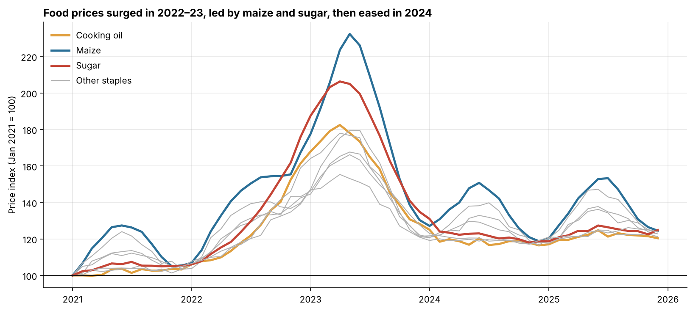
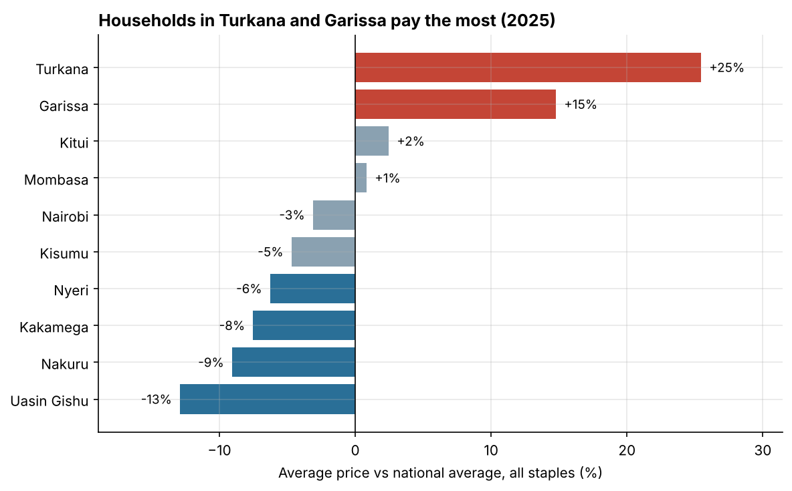
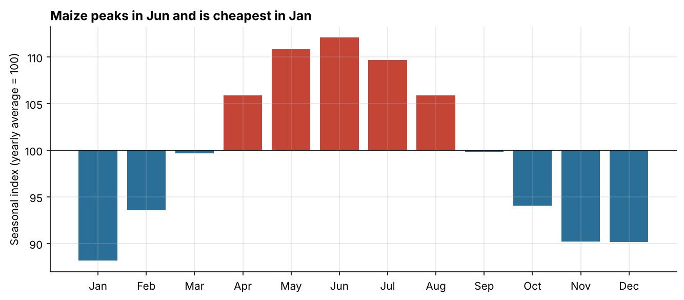

# Kenya Food Price Trends, 2021–2025

How have staple food prices moved across Kenya over five years, and where do households pay the most?
This project cleans and combines monthly market prices for **8 staples in 10 counties**, then analyses them with **Python** and an interactive **Excel** workbook (Tableau guide included).



## Key findings

| Finding | Detail |
| --- | --- |
| **2023 was the peak** for every staple | Sugar averaged KES 121/kg in 2021 and KES 208/kg in 2023 (+72%) |
| Maize, cooking oil and wheat flour also rose 54–64% | 2021 → 2023 annual averages |
| **Prices eased but didn't return to 2021 levels** | Sugar fell 31% and maize 27% from 2023 to 2025, still about 19% above 2021 |
| **Remote counties pay more** | In 2025 Turkana was 25% and Garissa 15% above the national average |
| **The grain basket is cheapest** | Uasin Gishu was 13% and Nakuru 9% below average |
| **Maize is seasonal** | Prices peak in June, before the long-rains harvest, and are lowest in January (a 24-point swing) |
| Maize is the most volatile staple | 6.5% average monthly price change |




## What I did
1. **Combined 10 messy county files** (4,730 raw rows) into one tidy table
2. **Cleaned the data:** standardised 20+ spelling variants of commodity and county names, converted 90 kg maize bags to price per kg, removed 30 duplicates and filled 150 missing prices by interpolation
3. **Built a price index** (Jan 2021 = 100) to compare commodities on one scale
4. **Analysed** national trends, county differences, seasonality and volatility in Python
5. **Built an Excel workbook** where every number is a live formula, with dropdowns to explore any commodity, county or year

## Excel workbook
[`excel/kenya_food_prices.xlsx`](excel/kenya_food_prices.xlsx)

| Sheet | What it does |
| --- | --- |
| Annual Averages | National average by commodity and year with `AVERAGEIFS`, 5-year change, peak year with `INDEX/MATCH` |
| County Comparison | Dropdown for commodity and year → ranks all counties with `RANK`, colour-coded gap vs national average, bar chart |
| Monthly Trend | Dropdown for commodity and two counties → 60-month line chart vs the national average |
| Data | 4,800 clean rows as an Excel Table |

## Tools
- **Python:** pandas, Matplotlib — [`notebooks/food_price_analysis.ipynb`](notebooks/food_price_analysis.ipynb)
- **Excel:** AVERAGEIFS, INDEX/MATCH, RANK, data validation, conditional formatting, charts
- **Tableau:** dashboard build guide — [`tableau_guide.md`](tableau_guide.md)

## Project structure
```
kenya-food-price-trends/
├── data/
│   ├── raw/                     # 10 messy county files
│   └── processed/food_prices_clean.csv
├── scripts/
│   ├── generate_data.py         # creates the raw files
│   ├── clean_data.py            # cleaning pipeline
│   └── build_excel.py           # builds the Excel workbook
├── notebooks/food_price_analysis.ipynb
├── excel/kenya_food_prices.xlsx
├── images/
├── tableau_guide.md
└── requirements.txt
```

## How to run
```bash
pip install -r requirements.txt
python scripts/clean_data.py
python scripts/build_excel.py
jupyter notebook notebooks/food_price_analysis.ipynb
```

## About the data
The prices are **synthetic**: `scripts/generate_data.py` simulates them to follow real Kenyan market patterns (the 2022–23 surge, seasonal maize cycles, higher prices in arid counties). They are not official statistics. For a real-data version, replace the raw files with the [WFP Kenya Food Prices dataset on HDX](https://data.humdata.org/dataset/wfp-food-prices-for-kenya) and rerun the scripts.

## Author
**[Your Name]** — Data Analyst · [LinkedIn](https://linkedin.com/in/yourname) · [Email](mailto:you@email.com)
